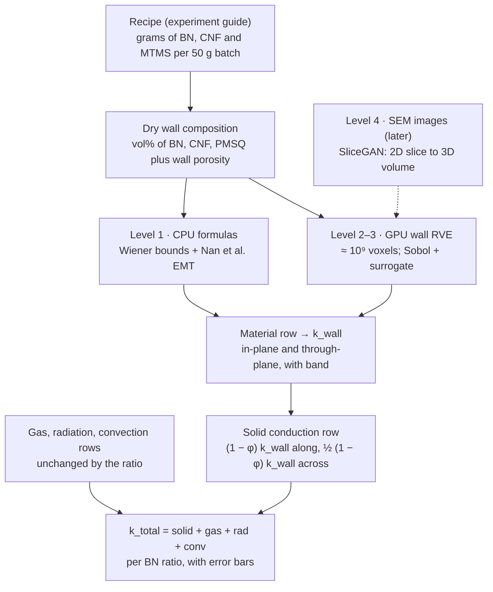
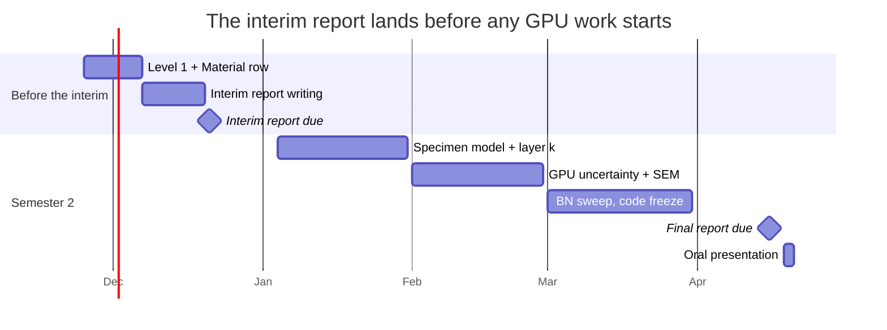

# FYP simulator: BN/C wall model, GPU plan and report split

24 Nov 2026. Markdown copy of the planning doc of the same name (the doc is the living version). The first solver now exists in this folder as one file, [`colab_k_cond.py`](colab_k_cond.py), instead of the `keff/` module plus notebook proposed below, and not in `aerosim/material/`; see [README.md](README.md) for its inputs and outputs. Paths like `docs/...` below are the aerosim app's docs (at the repo root until the folder split, then under `aerosim_html/`).

## Update 24 Nov: aim at the six laminates first

The methodology draft (3.1–3.4) changes the priority order below. This semester tests **six laminate layouts (L1–L5, P) with two fixed slurries (B10, C2.5)**, not a BN-ratio sweep. A simulation that cannot predict those six specimens will not meet the experiment chapter, however many GPU hours it burns.

**What the draft implies for the simulation**

- **Quantities to predict, per configuration:** through-thickness R″z = L/k_z, heater temperature rise in dark heating (2 W), temperature rise under 1000 W/m² solar-only, and the combined case.
- **Freezing direction:** a cold base with insulated top and sides grows channels through the thickness (guide issue E04). Then the measured direction is the aerogel's *high* one, k∥ ≈ 1.6 × k⊥ in the current model. Section 3.2 has to say which applies.
- **Resin infusion:** the CNT plies' aerogel, and possibly the BN top layer, fill with epoxy. That layer is a CNT/epoxy or BN/epoxy composite, not a dry aerogel (guide issue E08). Resin fill fraction becomes an input, taken from the measured mass gain.
- **Compositions:** B10 dry wall = 83 wt% BN. C2.5 solids = 1.25 g CNT + 0.50 g CNF + ≈ 0.49 g PMSQ, so ≈ 56 wt% CNT.
- **Table 2 in the draft:** the "CNF (g)" and "CNT (g)" columns hold stock and dispersion masses (12.50 g, 9.62 g). The dry masses are 0.50 g and 1.25 g. Relabel the headers.

**"Follow the real making process" = one model state per fabrication step,** each fed by the experiment's own records rather than by simulated ice physics:

| Fabrication step | Model state | Input it needs | Where the input comes from |
| --- | --- | --- | --- |
| Slurry | constituent volume fractions | recipe (Table 2) | the draft |
| Freeze-cast | pore size, wall thickness, channel direction | SEM | cross-section offcuts (3.3.1 keeps them) |
| Freeze-dry | dry aerogel layer k (existing simulator) | above | — |
| Resin infusion | infused layer k (BN or CNT walls + epoxy + voids) | fill fraction | measured mass gain |
| Cure | laminate stack of plies and layers | ply and layer thicknesses | measured |
| Coating | absorbed solar fraction 1 − R | spectral reflectance | 3.4.2–3.4.3 |
| Thermal test | 40 × 40 mm specimen, 20 × 20 mm heater, four supports, still air | heater power, irradiance, ambient | 3.4.4–3.4.5 |

Simulating the ice growth itself (phase-field freeze-casting) is the most GPU-hungry option and the least worth it: SEM of your own offcuts gives the structure more accurately, and PLAN.md already rules processing → structure out of scope.

**Re-ordered plan**

| Priority | Work | GPU? | What it gives the report |
| --- | --- | --- | --- |
| 1 | Specimen model: 3D conduction in the plate, with surface convection and radiation, solar absorbed as (1 − R) | CPU first; GPU for fine 3D and sweeps | predicted temperature rise per configuration, next to the measured one |
| 2 | Layer properties for the two fixed recipes: B10 dry and infused, C2.5 infused, anisotropic CFRP ply | GPU voxel RVE (Level 2), two recipes only | k of each layer with its band |
| 3 | Calibrate once on P (convection coefficient, heater contact), then predict L1–L5 without retuning | — | an honest blind test |
| 4 | Uncertainty through the whole chain | GPU, thousands of runs | temperature rise ± band; which input dominates |
| 5 | BN-ratio sweep (the old centerpiece) | GPU | the draft's own promise in 3.1: guide next semester's formulations |

**Expected results if this is adopted (estimates, not promises):**

- **Ranking of the six configurations:** likely right wherever measured differences exceed the model band. Below that the model says "within uncertainty", which is itself a defensible result.
- **Dark-heating temperature rise:** within roughly 10–20 % after calibrating on P. The convection coefficient and heater contact dominate, which is why P is the calibration case.
- **Solar-only:** good where measured reflectance drives it. The infrared emissivity is not measured (300–2500 nm only), so it stays a stated assumption.
- **Aerogel layer k:** trend and order of magnitude, about a factor of 2, until SEM and fill fraction are measured. The below-air gap for the dry aerogel (16.9 vs ≈ 26 mW/m·K) remains.
- **Section 3.2 for the interim:** 3.2.1 modelling chain (table above); 3.2.2 aerogel layer model (v0.1, built); 3.2.3 specimen model (planned); 3.2.4 verification and uncertainty.

## Update 24 Nov (2): what the slice math changes

The honeycomb slice derivation (walls k_w, cell interiors k_h) is already in the repo: docs/FUTURE_WORK.md §A has the same D₁, D₂ and the same ratio table. It adds no new predictor, but it changes three things in the GPU plan and exposes one label error.

**Directional k is solved except for one number.**

- **Along the channels:** k∥ = φ k_h + (1 − φ) k_w, exact, because straight channels are resistors in parallel.
- **Across the channels:** hexagonal symmetry gives one k⊥ for every in-plane direction. Any x ≠ y in a calculation is a discretization or model error, not physics.
- **k⊥ is the only number that needs numerics.** The formula sits ≈ 1 % under the Hashin–Shtrikman upper bound; the slice model is an upper bound (+22–27 % at the defaults); the exact value is a converged 2D solve.
- **Through the laminate thickness:** with the channels tilted by θ from the thickness normal (θ from SEM), a wide plate sees the conductivity tensor along its normal:

```
K = diag(k⊥, k⊥, k∥),   n = (sin θ, 0, cos θ),   k_n = nᵀ K n = k∥ cos²θ + k⊥ sin²θ
```

- **3D structures with bridges or tilt:** three periodic solves give the three columns of the full 3 × 3 tensor. That is a GPU job.

**Dry vs infused** (closed forms, d = 30 µm, t = 0.27 µm, k_wall = 4 W/m·K, t/l = 0.0156, φ = 0.982; values in mW/m·K):

| State | Cell fill | Contrast k_w/k_h | HS lower | Formula k⊥ | HS upper | Slice, x (upper bound) | k∥ (exact) | Doubling k_wall moves k⊥ by |
| --- | --- | --- | --- | --- | --- | --- | --- | --- |
| Dry | air, 26.11 | 153 | 27.0 | 61.2 | 61.9 | 78.0 | 96.7 | +58 % |
| Infused | epoxy, 200 (assumed) | 20 | 206.5 | 232.0 | 235.7 | 260.0 | 267.5 | +15 % |

- **Infused:** the bracket is 12 % wide and the wall barely matters, so the closed forms are enough. No GPU wall simulation for infused layers. The slice formula becomes a fair, labelled upper bound here (+12 %), as FUTURE_WORK §A.5 item 3 predicted.
- **Dry:** the bracket is 56 % wide and k_wall moves k⊥ by 58 %. This is where the GPU (true-thickness solve and wall RVE) earns its keep.
- **Physics flag for L1 and L2:** if resin floods the BN top layer, its conductivity rises ≈ 3.8× across and ≈ 2.8× along the channels. It stops insulating and becomes epoxy with a BN skeleton. Whether that layer stays dry is the biggest single question for the thermal comparison: check it by mass gain and cross-section.

**Changes to the plan**

1. **Split k_eff into its own module; the Colab notebook only imports it.** `aerosim/keff/`: `bounds.py` (Wiener, Hashin–Shtrikman, slice, lanes), `tensor.py` (assemble K, rotate to the laminate normal), `fv.py` (the periodic solver from `pixel_fv.solve`, generalised to 3D, NumPy or CuPy). `gpu/colab_keff.ipynb` = install from GitHub, job list, checkpoints; no physics inside the notebook, so CPU tests cover what the GPU runs.
2. **First GPU job = a known answer:** true-thickness 2D periodic solve. Pass criteria: reproduce the fitted-mesh FE value in the slide-10 review (k_w = 200, k_h = 0.026 W/m·K, t/l = 0.10: 11.17 / 11.18 W/m·K) within 0.5 %; x and y within 0.5 % of each other (5.5 % today, from the pixel staircase); at the defaults, land between the formula and the HS upper bound.
3. **Wall RVE (Level 2) only for layers that stay dry** (the BN top layer if the resin is kept out), plus a check on the CNT layer; dropped for infused BN.
4. **Slice model:** still a bound, not a method; shown as "upper bound" for infused layers.
5. **Label fix:** FUTURE_WORK §A.4 labels contrast 7692 as "4 W/m·K walls, air". 7692 = 200/0.026; 4/0.026 = 154. The ratios are right, the label is wrong. The FYP's own contrasts are ≈ 154 (dry) and ≈ 20 (infused).

## Short answer

Turn the empty Material row into a **BN : CNF : MTMS → k_wall** model that feeds Solid conduction, and spend the GPUs on resolving the wall's microstructure, not on making the existing rows bigger.

- **Level 1 (CPU, now):** recipe → dry wall composition → wall-conductivity bounds and an effective-medium estimate. Hand-checkable; answers the supervisor's request directly.
- **Level 2 (H100/A100):** a 3D voxel picture of one wall patch (BN platelets + CNF/PMSQ binder + optional nanopores) solved for its conductivity tensor, with interface and sheet-to-sheet contact resistances. Many random copies per ratio.
- **Level 3 (GPU-fed, laptop-served):** uncertainty and sensitivity over the unknown inputs, plus a surrogate table so the UI stays instant without a GPU.
- **Level 4 (when SEM exists):** SEM → SliceGAN → 3D structure → GPU solve, for the real walls and the real channel network.

Do **not** burn compute units on 3D convection (Ra ≈ 7 × 10⁻⁸: paying to prove zero), DSMC at 1 atm, or your own molecular dynamics.

The warning that shapes everything: measured BN/CNF films at **50 wt% BN** range from **1.2 to 145.7 W/m·K** between labs. Composition alone does not set k_wall; microstructure does. So the deliverable per ratio is a **k_wall band with the reason for its width**, not one confident number.

## What the BN/C ratio changes in the code

The ratio enters through one number, k_wall, and that number is already the biggest lever in the model. At the defaults the solid term is 71.0 of 96.8 mW/m·K along the channels (73 %) and 35.5 of 61.3 across (58 %).

```
k_solid,∥ = (1 − φ) k_wall,     k_solid,⊥ = ½ (1 − φ) k_wall
```

- **Today:** k_wall = 4.0 W/m·K, one number, *derived* from Chan et al. 2022 (BNNS/WPU, a different binder). Changing BN content changes nothing in the model.
- **What Kit asked for (transcript ≈ 00:18):** BN has its own conductivity, the binder has its own, use their proportions to compute an effective wall conductivity and give that to the cell model. That is exactly a Material row that outputs k_wall.
- **Why only the in-plane wall conductivity matters:** in a thin-wall honeycomb heat runs *along* the walls, in both directions (that is what the cos² average says). The through-wall value only enters through gas–wall coupling in Pixel FV. The ice front pushes BN platelets parallel to the wall (transcript ≈ 00:19), so the wall's in-plane direction is also BN's high direction: good for k∥, bad for insulation.
- **How I read "C":** CNF, the cellulose binder (Kit's "C—NF" at 00:17:32; the B series is BN/CNF/MTMS). The CNT interlayer (C series) uses the same machinery with CNT instead of BN, as a second preset later. Correct me if you meant CNT.

## Recipe → wall composition

"B10" is not a 10 % BN wall: it is an 83 wt% (77 vol%) BN wall, because the water leaves and only the solids build the walls. Every B-series wall is at least 62 vol% BN, so BN is the continuous phase and the binder is thin glue between sheets.

| Group | BN in slurry (wt%) | BN in dry wall (wt%) | CNF (wt%) | PMSQ (wt%) | BN (vol%) | BN : CNF (mass) |
| --- | --- | --- | --- | --- | --- | --- |
| B0 | 0 | 0 | 50.4 | 49.6 | 0 | — |
| B5 | 5 | 71.6 | 14.3 | 14.1 | 62.1 | 5 : 1 |
| B10 | 10 | 83.4 | 8.3 | 8.2 | 76.6 | 10 : 1 |
| B20 | 20 | 91.0 | 4.5 | 4.5 | 86.7 | 20 : 1 |
| B30 | 30 | 93.8 | 3.1 | 3.1 | 90.8 | 30 : 1 |
| Chan 2022 (BNNS/WPU) | 10 | 87.7 (WPU 12.3) | — | — | — | — |

From the guide's 50 g batches (0.50 g dry CNF, 1.00 g MTMS feed). Assumptions, all *hypothetical*: MTMS fully condenses to CH₃SiO₁.₅ (mass yield 67.12/136.22 = 0.493; the guide leaves retention unspecified); densities BN 2.1, cellulose 1.5, PMSQ 1.25 g/cm³ (the PMSQ value is a placeholder).

**Consequence:** the classic dilute mixture models (Maxwell-type, Nan et al. with CNF as the matrix) are outside their validity range for every real B-group. That failure is the main reason Level 2 exists.

**A finding worth checking in Chan 2022 before anything else:** the repo's wall density is 20.2/0.018 = **1.12 g/cm³**, but a dense 88 wt% BN/WPU wall would be about **1.89 g/cm³**. Either the walls are about 40 % nanoporous (solid fraction 0.59), or the paper's porosity used a different skeleton density. If the walls are porous, k_wall drops and the gas in those nanopores is Knudsen-suppressed: the same "nanoporous walls" candidate the README already lists for the measured 16.9 mW/m·K sitting below air. Wall porosity therefore becomes an explicit Material input.

## Literature anchors

The constituent values are known to within a factor of two; the contacts between them are not, and the contacts decide k_wall at high BN loading.

| Input | Value | Status | Source |
| --- | --- | --- | --- |
| h-BN, in-plane (bulk) | ≈ 325 measured for natural isotopes (585 for pure ¹⁰B is ≈ 80 % higher); ≈ 550 predicted | literature | [Yuan et al. 2019](https://www.nature.com/articles/s42005-019-0145-5) |
| h-BN, through-plane | ≈ 2–5 W/m·K; falls 40× from 585 nm to 7 nm flakes | literature | [Jaffe et al. 2021](https://arxiv.org/abs/2103.07452); [Jiang et al. 2018](https://doi.org/10.1103/PhysRevMaterials.2.064005) |
| BNNS "1700–2000 W/m·K" | monolayer theory, not a wall in a freeze-cast aerogel | do not use | quoted in [Kong et al. 2022](https://doi.org/10.3389/fmats.2021.817061) |
| CNF film, in-plane | ≈ 1.34 W/m·K; CNC intrinsic ≈ 2.0 | literature | [Xu et al.](https://www.osti.gov/pages/servlets/purl/1892395); [Li et al. 2021](https://doi.org/10.1016/j.ijheatmasstransfer.2021.121043) |
| PMSQ (MTMS-derived) solid | no bulk value found; polymer-like, assume 0.1–0.3 W/m·K | hypothetical | — |
| BN–binder interface resistance R_K | order 10⁻⁸ m²K/W; 0.6 × 10⁻⁸ is reported as exceptionally low for BN/polymer | literature (order) | [Mater. Horiz. 2025](https://pubs.rsc.org/en/content/articlepdf/2025/mh/d5mh00738k); MD for h-BN/CNC in [Li et al. 2021](https://doi.org/10.1016/j.ijheatmasstransfer.2021.121043) |
| BN–BN sheet contact R_c | unknown; likely the controlling resistance above ≈ 60 vol% BN | hypothetical, swept | — |
| Sheet diameter, thickness, alignment | from the BN grade's datasheet, TEM, SEM | hypothetical until measured | — |
| Wall porosity | 0–40 % (see the density check above) | derived / hypothetical | Chan et al. 2022 |

**Same composition, two orders of magnitude apart:**

| Material | BN content | In-plane k (W/m·K) | Source |
| --- | --- | --- | --- |
| BN/NFC paper | 50 wt% | up to 145.7 | [Zhu et al. 2014](https://doi.org/10.1021/nn500134m) |
| BNNS/CNF film | 90 wt% | 82.4 | [Kong et al. 2022](https://doi.org/10.3389/fmats.2021.817061) |
| Chan 2022 aerogel wall (BNNS/WPU) | 87.7 wt% | ≈ 4 (back-calculated) | repo, PHYSICS.md §2.1 |
| BNNS/CNF nano-paper, aerogel template | 50 wt% | 2.4 (at 70 °C) | [Wang et al. 2019](https://doi.org/10.3390/polym11040660) |
| BNNS/CNF nano-paper, blended | 50 wt% | 1.2 (at 70 °C) | [Wang et al. 2019](https://doi.org/10.3390/polym11040660) |

The repo's 4 W/m·K sits near the bottom of the film range, which fits loosely packed sheets in a 0.27 µm freeze-cast wall. The model has to expose the knobs that move k along this range (sheet size, alignment, contacts, wall porosity) instead of hiding them inside one fitted k_wall.

## How the pieces connect



Only the Solid conduction row reads the Material result; gas, radiation and convection see the ratio only if wall porosity or wall optics are later tied to it.

## The proposal: four levels

Each level follows the repo's existing rule: the detailed method must first reproduce the fast one in the ideal case before it is trusted where the fast one cannot go. Before building, read [Kim et al. 2023](https://pubs.rsc.org/en/content/articlehtml/2023/ta/d2ta09983g) (Kit's group): it proposes its own way to estimate the anisotropic k of these aerogels, and the report should position this tool against it.

### Level 1: mixture formulas (fast, CPU)

- **In:** recipe grams or a BN : CNF : PMSQ ratio, densities, wall porosity, sheet aspect ratio, alignment, R_K.
- **Out:** k_wall in-plane and through-plane, with the parallel (upper) and series (lower) Wiener bounds and a [Nan et al. 1997](https://www.scilit.net/publications/a3dc66b2b83215878b30abec91434907) estimate for aligned anisotropic platelets with interface resistance. A symmetric Bruggeman estimate as a second opinion at high loading.
- **Why:** instant and checkable by hand; the band between the bounds is the honest headline. It has no percolation or sheet-contact physics, and that blind spot is exactly what Level 2 measures.

### Level 2: wall RVE on the GPU (detailed)

- **Picture:** a periodic 3D voxel box of one wall patch, true wall thickness (0.27 µm) through z and a few µm in-plane. BN sheets are thin discs placed by a packing generator (stacked brick-and-mortar layers at high loading, random sequential addition at low), tilted by an alignment parameter. Binder fills the gaps; optional nanopores carry Knudsen gas.
- **Physics:** the same heat balance as `pixel_fv.solve`, in 3D. Each BN voxel conducts along its sheet's plane and across it. A face between BN and binder gets R_K in series; a face between two *different* sheets (a sheet id per voxel) gets R_c. Percolation and contact physics then come out of the geometry, with no fitting.
- **Solver:** matrix-free conjugate gradient in CuPy (NumPy-like, falls back to NumPy), periodic with a temperature jump per period as in Pixel FV, three directions → the wall's conductivity tensor.
- **Why an H100:** about 36 bytes per voxel in float32 means roughly 1 × 10⁹ voxels on 80 GB and 5 × 10⁸ on a 40 GB A100 (my estimate). That is 2 nm voxels over a 2.5 × 2.5 µm patch at true thickness: enough to resolve few-nm sheets. Resolution is the reason, not speed for its own sake.
- **Ensemble:** for example 5 ratios × 4 alignments × 3 contact resistances × 10 random seeds = 600 solves.
- **Cross-check:** [TauFactor 2](https://joss.theoj.org/papers/10.21105/joss.05358) (GPU, PyTorch, has a multi-phase solver) on cases without interface resistance.

### Level 3: uncertainty, sensitivity, surrogate

- Latin-hypercube sample the unknowns (sheet size and thickness, alignment, R_K, R_c, wall porosity, k of CNF, PMSQ, BN), run Level 2, get a k_wall distribution per ratio.
- Sobol indices (SALib) say which unknown matters most, which tells Kit which measurement to pay for first. PLAN.md §3 already promised this chart for v0.2.
- Fit a small surrogate (Gaussian process or a lookup table), commit it as `results/material_surrogate.npz`. The UI's detailed Material method reads it instantly on a laptop: GPU offline, CPU online.
- k⊥, k∥ and the anisotropy get error bars instead of three significant figures of false confidence.

### Level 4: real structure from SEM (when images exist)

- [SliceGAN](https://arxiv.org/abs/2102.07708) trains on a 2D micrograph and generates statistically matching 3D volumes; [MicroLib](https://www.ncbi.nlm.nih.gov/pmc/articles/PMC9588049/) shows it across many materials.
- **Use 1:** wall cross-sections (SEM/TEM) → a realistic wall RVE in place of generated discs.
- **Use 2:** aerogel SEM → 3D channels with real bridges, waviness and holes → 3D voxel solve. This attacks the anisotropy gap (model 1.6–2.0, measured ≈ 5.8) that straight extruded hexagons cannot reach; BNNS are reported to turn transverse ligaments into whiskers ([Yang et al.](https://khazna.ku.ac.ae/en/publications/superinsulating-bnnspva-composite-aerogels-with-high-solar-reflec/)).
- **Caveat:** SliceGAN was built for isotropic materials and freeze-cast aerogels are strongly anisotropic. It needs an SEM view per direction and a check that generated slices match real ones (porosity, wall-thickness distribution, two-point correlation).

## Where the GPUs are worth it

The GPU pays off only where it buys structure the formulas cannot see; it fixes no unknown input. Ranked by value for the FYP:

| # | Option | What it improves | GPU need | Verdict |
| --- | --- | --- | --- | --- |
| 1 | Level 1 mixture formulas | composition → k_wall at all | none | do first |
| 2 | Level 2 wall RVE | k_wall vs ratio, with percolation and sheet contacts | high (H100) | core GPU work |
| 3 | Level 3 UQ + surrogate | error bars; which input matters | high (hundreds of solves) | do with 2 |
| 4 | Level 4 SEM → SliceGAN → 3D | real walls and channels; the anisotropy gap | high (training + 3D solves) | as soon as SEM exists |
| 5 | Pixel FV at true wall thickness (≈ 445 px per cell) | removes the 4-px-wall and solid-fraction shortcut | low–medium | quick win: verifies a shortcut |
| 6 | 3D Pixel FV with procedural freeze-cast features (bridges, tilt, waviness) | k⊥, k∥, anisotropy | medium | optional bridge until SEM |
| 7 | Spectral radiation with literature h-BN infrared optical constants | replaces the hypothetical wall absorption | low (CPU) | later |
| 8 | 3D lattice Boltzmann convection | nothing: Ra ≈ 7 × 10⁻⁸ | — | skip |
| 9 | DSMC gas | matters only at low pressure | — | skip at 1 atm |
| 10 | Your own molecular dynamics for R_K | one interface number | very high, months to learn | use published MD values |

On option 7: the experiment's integrating sphere covers 300–2500 nm, but thermal radiation at 300 K peaks near 9.7 µm (Wien: 2898/300). The planned reflectance data will **not** fix the radiation inputs; that needs FTIR or literature optical constants. Worth one sentence in the report.

## How it plugs into the repo

The existing architecture already supports this with two small changes: row order and one `USES` entry.

- **Row order:** Material moves from ORDER 6 to 2 (right after Structure) so it runs before Solid conduction.
- **No double counting:** Material returns `k_wall_in`, `k_wall_thru`, `rho_wall`, the band, and `covers = []`. It supplies an input, not a heat path, and `state.totals()` already skips rows with empty `covers`.
- **Solid methods:** `formula.py` and `pixel_fv.py` get `USES = ["material"]` and take k_wall from the Material result when one exists, else today's 4.0 W/m·K default. The "re-run" staleness logic already follows `USES`.
- **New files:** `aerosim/material/mixture.py` (fast), `aerosim/material/wall_rve.py` (detailed: reads the surrogate, can run a small CPU RVE), `aerosim/material/_rve_core.py` (generator + solver, NumPy/CuPy switch), `gpu/colab_wall_rve.ipynb` (batch runner), `results/material_rve.csv`, `results/material_surrogate.npz`. The placeholder retires.
- **Dependencies:** CuPy as an optional extra (`pip install -e ".[gpu]"`). The README's promise holds: the tool runs on NumPy + SciPy alone.
- **Colab hygiene:** GPU type is not guaranteed and Pro+ caps continuous runs at 24 h ([Colab limits](https://www.hivenet.com/post/google-colaboratory-gpu-complete-guide-to-free-cloud-gpu-access-and-limitations)), so design for being killed: a job list, one result row appended to Drive per solve, resume where it died, every seed fixed, GPU type, library versions and wall time logged.
- **Repo rules (CLAUDE.md):** tests in `.agent/tests/` at tiny CPU sizes; README backend table and DESIGN.md §2 updated in the same commit; every new input carries value, unit, status, source, help.
- **Honesty rule:** no tuning R_c until the model hits Chan's 4 W/m·K or Zhu's 145.7. They are checks. If you calibrate at all, calibrate on one dataset, test on another, and say so.

## Validation ladder

The wall RVE earns trust in the same order as Pixel FV did: exact cases first, then limits, then convergence, then the outside world.

1. Uniform box → exactly k in all three directions.
2. Layers in series and in parallel → the Wiener values exactly.
3. Dilute aligned discs with R_K = 0 → Nan / Maxwell within a few %.
4. R_K → ∞ with isolated sheets → sheets behave as holes (the lower-bound limit).
5. Energy balance |Q_in − Q_out| / Q_in below the CG tolerance (target 10⁻⁸).
6. Halving the voxel size changes k_wall by < 5 %; doubling the box by < 5 %; seed-to-seed scatter reported, not hidden.
7. CPU and GPU give the same answer on a small case; TauFactor 2 agrees where it applies.
8. Outside world, reported and not fitted: does the model land inside the film spread (1.2–145.7 W/m·K) and near Chan's ≈ 4 W/m·K for plausible inputs, and which inputs put it where?

## Timeline



Everything before 21 Dec is CPU work; the GPU levels start in January so they cannot eat the interim. The interim needs Level 1, the composition table and this plan for Levels 2–4. After the 24 Nov update, January builds the specimen model and the layer properties for B10 and C2.5; the BN-ratio sweep moves to March.

## Report: the simulation part, split

Write the simulation as two chapters of about **8,500 words** with about 16 figures and tables; most of the text already exists in `docs/PHYSICS.md` and only needs turning into report prose. These two chapters carry Methodology (12.5) and Results and Discussion (15), so 27.5 of the 50 final-report marks. The guidelines set no page limit but ask for concision and at most five conclusions.

**Chapter 3: Simulation method (≈ 4,800 words)**

| § | Section | What goes in | Words | Figures / tables | Already in the repo | Interim? |
| --- | --- | --- | --- | --- | --- | --- |
| 3.1 | Scope and strategy | dry skeleton only; meeting constraints (pore size first, porosity from geometry); k_total split; two levels per path and the reproduce-first rule; why not CFD or MD | 600 | Fig: multiscale chain | PLAN §0a, §1–2; README Backend | yes |
| 3.2 | Geometry | pitch, porosity, density from d and t; defects picture; 4-px wall shortcut | 600 | Fig: unit cell + defects picture; Table: defaults with status | PHYSICS §1 | yes |
| 3.3 | Wall material model (new) | recipe → wall composition; bounds and EMT; GPU RVE; wall porosity | 900 | Table: B0–B30 composition; Fig: RVE render | this doc | as a plan |
| 3.4 | Solid conduction | full cos² derivation; Pixel FV with periodic jump; why periodic | 700 | Fig: temperature field | PHYSICS §2; FUTURE_WORK A | yes |
| 3.5 | Gas conduction | Knudsen; local Kn; Monte Carlo chords; what "pore size" means | 600 | — | PHYSICS §3 | yes |
| 3.6 | Radiation | opaque walls, Rosseland validity, ray tracing; the infrared-optics gap | 500 | — | PHYSICS §4 | yes |
| 3.7 | Convection | Rayleigh → 0; LBM benchmark as proof | 300 | — | PHYSICS §5 | yes |
| 3.8 | Implementation | method-file contract; input status labels; UI; GPU offline, CPU online | 400 | Fig: UI screenshot | README; DESIGN | short |
| 3.9 | Verification and uncertainty method | the test list; sampling and Sobol design | 400 | Table: verification tests | `.agent/tests`; this doc | short |

**Chapter 4: Simulation results and discussion (≈ 4,000 words)**

| § | Section | What goes in | Words | Figures / tables | Already in the repo | Interim? |
| --- | --- | --- | --- | --- | --- | --- |
| 4.1 | Verification results | hand numbers to 12 digits; energy balance 10⁻¹²; grid < 3 %; LBM Nu 2.09 / 2.62; Hashin–Shtrikman bounds | 500 | Table: check, expected, obtained | FUTURE_WORK B; PHYSICS | yes |
| 4.2 | Baseline breakdown | 61.3 / 96.8 mW/m·K, anisotropy 1.58; Pixel FV 59.3 / 95.9 | 400 | Fig: stacked bars per path, both directions | PHYSICS §7 | yes |
| 4.3 | Pore-size sweep | modes A, B, C; size matters through porosity | 600 | Fig: k vs d, three modes | `results/sweep.csv` | yes |
| 4.4 | Defects | 5 % cracks: k⊥ −23 %, anisotropy 2.03 | 400 | Fig: k vs crack fraction | PHYSICS §2.2 | yes |
| 4.5 | Composition sweep (new) | k_wall band vs BN fraction (Level 1) with RVE points (Level 2); k_total vs ratio | 800 | Fig: k_wall vs BN vol% with bounds and RVE points | new | Level 1 only |
| 4.6 | Uncertainty and sensitivity (new) | Sobol bars; error bars on k_total | 500 | Fig: Sobol indices | new | no |
| 4.7 | Model vs measurement | below-air floor (16.9 vs ≈ 26 mW/m·K); anisotropy 1.6–2.0 vs 5.8; causes: nanoporous walls, test method, 3D bridges | 600 | Table: model vs measured | README note 5 | yes |
| 4.8 | Limitations | the shortcut list and the hypothetical inputs | 200 | — | FUTURE_WORK B | yes |

**Appendices:** A worked example (PHYSICS §7); B slice-model proof (FUTURE_WORK A); C full input register with status and source; D code availability and test list; E GPU run log (hardware, time, seeds).

**Interim report (21 Dec):** the rows marked yes, condensed, ≈ 4,000 words for the simulation part, plus the timeline above as project management. The interim is marked on appropriate methodology, preliminary results, planning and progress, so 3.3 as a plan with the composition table is enough.

**Rubric hooks to hit on purpose:** discrepancies between model and measurement analysed (4.7); awareness of other investigative methods (3.1); self-driven learning (the GPU and SEM work).

## Decisions needed

Six answers unblock the build; the first two decide what Level 1 even computes.

- [ ] **"C" = CNF or CNT?** I built this on CNF (the BN surface layer); CNT becomes a second preset either way.
- [ ] **How Chan 2022 computed φ = 0.982** (which skeleton density). Decides whether walls are ≈ 40 % porous. Ask Kit or check the paper's methods.
- [ ] **BN grade:** lateral size and thickness from the datasheet or TEM. Replaces two hypothetical inputs.
- [ ] **SEM by February?** Wall cross-sections and both aerogel sections. Decides Level 4 versus the procedural 3D option.
- [ ] **GPU budget:** how many Colab compute units a month you actually get. Sets the ensemble size.
- [ ] **Calibration allowed?** CLAUDE.md says no tuning. I'd keep it that way and report "what R_c would have to be" as an analysis, not a fit.

## Sources

Most values above come from abstracts and search results; check page numbers and exact figures in the full texts before they go into the report (same rule as README note 3).

- [Chan et al. 2022, Nat. Commun. 13:5553](https://www.ncbi.nlm.nih.gov/pmc/articles/PMC9499976/)
- [Kim et al. 2023, J. Mater. Chem. A](https://pubs.rsc.org/en/content/articlehtml/2023/ta/d2ta09983g)
- [Yang et al., BNNS/PVA aerogels](https://khazna.ku.ac.ae/en/publications/superinsulating-bnnspva-composite-aerogels-with-high-solar-reflec/)
- [Zhu et al. 2014, ACS Nano 8:3606](https://doi.org/10.1021/nn500134m)
- [Kong et al. 2022, Front. Mater. 8:817061](https://doi.org/10.3389/fmats.2021.817061)
- [Wang et al. 2019, Polymers 11:660](https://doi.org/10.3390/polym11040660)
- [Xu et al., CNF/BNNS composites (OSTI)](https://www.osti.gov/pages/servlets/purl/1892395)
- [Li et al. 2021, Int. J. Heat Mass Transf. 171:121043](https://doi.org/10.1016/j.ijheatmasstransfer.2021.121043)
- [Yuan et al. 2019, Commun. Phys.](https://www.nature.com/articles/s42005-019-0145-5)
- [Jaffe et al. 2021, cross-plane h-BN](https://arxiv.org/abs/2103.07452)
- [Jiang et al. 2018, Phys. Rev. Mater. 2:064005](https://doi.org/10.1103/PhysRevMaterials.2.064005)
- [Nan et al. 1997, J. Appl. Phys. 81:6692](https://www.scilit.net/publications/a3dc66b2b83215878b30abec91434907)
- [BN/polymer Kapitza resistance, Mater. Horiz. 2025](https://pubs.rsc.org/en/content/articlepdf/2025/mh/d5mh00738k)
- [Platelet percolation, Atashpendar et al.](https://arxiv.org/abs/2001.09894)
- [TauFactor 2, JOSS 2023](https://joss.theoj.org/papers/10.21105/joss.05358)
- [SliceGAN, Kench & Cooper 2021](https://arxiv.org/abs/2102.07708)
- [MicroLib, Sci. Data 2022](https://www.ncbi.nlm.nih.gov/pmc/articles/PMC9588049/)
- [Colab GPU limits](https://www.hivenet.com/post/google-colaboratory-gpu-complete-guide-to-free-cloud-gpu-access-and-limitations)
- Repo: `saul-gitman/FYP` main @ e16ea07 (README, PHYSICS.md, PLAN.md, FUTURE_WORK.md, guide/02_Experiment, guide/08_Transcripts)
